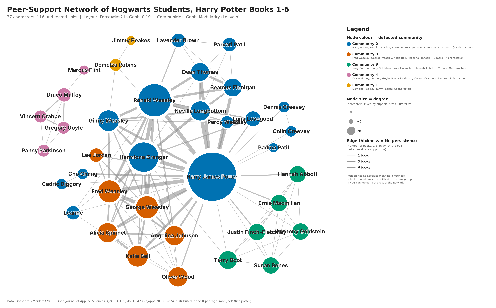

# Graph-Based Analysis and Visualization of Character Interactions in the Harry Potter Universe

A B.Tech network-science project. It models **peer-support interactions between Hogwarts
students (Harry Potter Books 1–6)** as a graph, visualizes it with **Gephi**, and analyses it
with **degree centrality, betweenness centrality and modularity (Louvain) communities**.



## Key results

| | |
|---|---|
| Graph | 37 characters, 116 undirected links, density 0.174, 2 components |
| Highest degree | Harry Potter (28), Ron Weasley (17), Hermione Granger (15) |
| Highest betweenness | Harry (297.9), Ron (42.4), **Demelza Robins (30.0, only 3 links)** |
| Communities (Gephi) | 5, modularity Q = 0.271 |

**Insights:** (1) Harry is both the hub and the main bridge; removing him cuts off five
characters. (2) The Slytherin students form a separate component with zero support links to
other houses. (3) High degree does not imply high betweenness (Demelza vs Fred/George).
(4) Communities follow friendship and team groups more than houses.
Details: [`analysis/findings.md`](analysis/findings.md).

## Dataset

Bossaert, G. & Meidert, N. (2013). *Open Journal of Applied Sciences*, 3(2), 174–185.
[doi:10.4236/ojapps.2013.32024](https://doi.org/10.4236/ojapps.2013.32024). Obtained from the
`fict_potter` dataset in the R package [manynet](https://github.com/stocnet/manynet).
An edge means one student was coded as giving another emotional, practical or informational
support, or praise. See [`data/README.md`](data/README.md) for preprocessing.

## Project structure

```
harry-potter-network/
├── data/
│   ├── raw/                     original .rda + raw CSVs (64 characters, 544 directed ties)
│   ├── nodes.csv                Gephi node table (37 characters)
│   ├── edges.csv                Gephi edge table (116 undirected, weighted edges)
│   └── README.md                source, meaning, preprocessing
├── scripts/
│   ├── prepare_data.py          raw data -> nodes.csv / edges.csv
│   ├── validate_data.py         data-quality checks
│   ├── compute_metrics.py       NetworkX metrics + insight checks (cross-check of Gephi)
│   ├── compare_gephi_python.py  confirms Gephi and Python metrics match
│   └── add_legend.py            adds title + legend frame around the Gephi PNG
├── gephi_toolkit/
│   ├── GephiPipeline.java       Gephi Toolkit: import, statistics, layout, styling, export
│   └── run.sh                   downloads Gephi Toolkit 0.10.1, builds and runs it
├── analysis/
│   ├── centrality_results.csv   degree, weighted degree, betweenness, ranks (Python)
│   ├── gephi_node_metrics.csv   the same metrics + modularity class, computed by Gephi
│   ├── gephi_communities.csv    community colours and sizes
│   ├── gephi_statistics_summary.txt
│   ├── gephi_vs_python_check.txt
│   ├── metrics_log.txt
│   └── findings.md              interpretation of the results
├── visualization/
│   ├── harry_potter_network.png            final figure (Gephi export + legend), 5750×3580
│   ├── harry_potter_network_gephi_raw.png  raw Gephi PNG export, 4000×3200
│   ├── harry_potter_network.pdf            Gephi vector export
│   └── gephi_project.gephi                 native Gephi project (open in Gephi Desktop)
├── report/
│   ├── project_report.md        1–2 page academic report
│   ├── presentation_script.md   4-minute talk + likely questions
│   └── gephi_instructions.md    beginner steps to redo everything in Gephi Desktop
└── requirements.txt
```

## How the Gephi output was produced

The visualization and its metrics were produced by **Gephi's own engine**: the official
[Gephi Toolkit 0.10.1](https://github.com/gephi/gephi-toolkit), the same code as Gephi Desktop,
run as a script (`gephi_toolkit/GephiPipeline.java`). The script follows the Desktop workflow:
spreadsheet import, Statistics (Degree, Weighted Degree, Network Diameter, Modularity),
ForceAtlas2, then Prevent Overlap and Label Adjust, Appearance ranking and partition, Preview,
Export, and Save Project. The `.gephi` file opens in Gephi Desktop.

To do the same steps by hand in Gephi Desktop, follow
[`report/gephi_instructions.md`](report/gephi_instructions.md).

The only non-Gephi step is `scripts/add_legend.py`. Gephi cannot draw legends, so this
script places the unmodified Gephi PNG on a larger canvas with a title and legend.

## Reproduce

```bash
pip install -r requirements.txt
python scripts/prepare_data.py        # build nodes.csv / edges.csv
python scripts/validate_data.py       # data-quality checks
python scripts/compute_metrics.py     # Python metrics + insight checks
bash gephi_toolkit/run.sh             # Gephi: stats, layout, styling, PNG/PDF/.gephi (needs Java 11+)
python scripts/compare_gephi_python.py
python scripts/add_legend.py          # final PNG with legend
```

On a Linux server without a display, `run.sh` uses `xvfb-run` automatically (Gephi's PNG
exporter needs a graphics environment).
